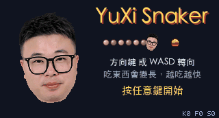
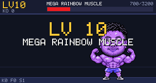
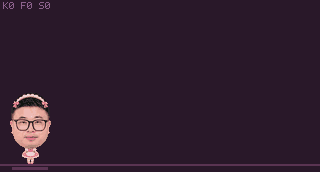
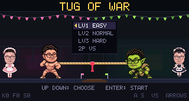
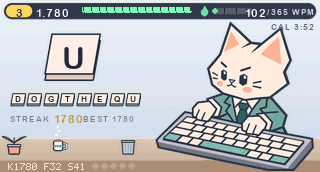
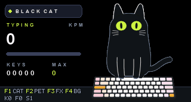

# Rainy75 V2 IPS GameHub

把 Rainy75 V2 鍵盤的 IPS 小螢幕（320×172）變成一台「小霸王遊戲機」：**一個固件裡內建多款小遊戲與桌寵，開機就是遊戲選單**，之後仍會持續新增玩法。

- 只修改螢幕副控，不動鍵盤主控與接收器，隨時可刷回原廠固件。
- 所有遊戲都在鍵盤端直接運行，日常遊玩不需要在電腦上開任何後台程式。
- 休眠或斷電重開後自動回到上次在玩的遊戲（或停在選單、游標指向上次遊玩的項目）。

---

## Game Hub v10：一個固件，18 款遊戲與桌寵

刷一次 [`game-hub-v10`](firmware/collection/game-hub-v10/)，螢幕開機即進入遊戲選單：**`↑` / `↓` 選擇遊戲、`Enter` 進入；遊戲中 2 秒內連按 5 次 `Esc` 返回選單**（中間按別的鍵會重新計算，平常打字不誤觸）。

| # | 遊戲 | 簡介 | 圖片素材 |
|---|---|---|---|
| 1 | [SNAKE](#1-snake貪吃蛇) | 經典貪吃蛇 | — |
| 2 | [YUXI SNAKER](#2-yuxi-snaker) | 頭像版貪吃蛇，吃美食越吃越快 | `AVATAR.BIN` |
| 3 | [MUSCLE VS GOBLIN](#3-muscle-vs-goblin猛男-vs-哥布林) | 同一把鍵盤雙人格鬥 | `FIGHT.BIN` |
| 4 | [TYPING BOSS](#4-typing-boss打字打怪) | 打字攻擊 Boss，10 關挑戰 | `BOSS.BIN` |
| 5 | [TYPING PET](#5-typing-pet打字電子雞) | 打字餵電子雞，從蛋養到國王 | `PET.BIN` |
| 6 | [COMBO COUNTER](#6-combo-counter打字連擊) | 打字連擊數＋即時 WPM 特效 | — |
| 7 | [LETTER RAIN](#7-letter-rain字母雨) | 按下的鍵化為鍵帽從天而降 | — |
| 8 | [KEY HEATMAP](#8-key-heatmap按鍵熱圖) | 75% 配列即時按鍵熱圖 | — |
| 9 | [MAID YUXI](#9-maid-yuxi粉色女僕) | 粉色女僕，打字就飛、冒愛心 | — |
| 10 | [BIGHEAD MAID YUXI](#10-bighead-maid-yuxi粉色女僕大頭版) | 同上，大頭版 | — |
| 11 | [CODE MASTER](#11-code-master數字密碼破解) | 駭客終端風格數字密碼破解，10 節點闖關 | — |
| 12 | [KEY GUARD](#12-key-guard鍵盤塔防) | 打字賺能量、主行鍵蓋炮塔，守住 20 波 Bug | `GUARD.BIN` |
| 13 | [TUG OF WAR](#13-tug-of-war拔河對決) | 猛男 vs 哥布林拔河，1P 三關或雙人 | `TUG.BIN` |
| 14 | [WOB QC](#14-wob-qc鍵盤工廠質檢) | 鍵盤工廠傳送帶質檢：蓋章、彈飛、分箱 | `WOBQC.BIN` |
| 15 | [KEYQUARIUM](#15-keyquarium鍵盤水族館) | 打字餵魚的水族箱，越打越熱鬧 | `AQUA.BIN` |
| 16 | [OFFICE CAT](#16-office-cat辦公室貓咪) | 小貓陪你打字，依速度與退格判斷工作狀態 | `OFFCAT.BIN` |
| 17 | [SHARINGAN](#17-sharingan寫輪眼桌布) | 寫輪眼互動桌布：越打越進化、越打轉越快 | `SHARINGN.BIN` |
| 18 | [KUROCAT](#18-kurocat打字小貓桌寵) | 5 皮膚打字小貓桌寵：伸爪敲鍵、甩尾拍鍵、摸頭呼嚕、4 套純色背景 | `KUROCAT.BIN` |

---

## 安裝與管理教程

### 開始前準備

- **有線連接**：請使用 **USB 數據線**直接連接鍵盤（2.4G 接收器與藍牙無法燒錄或傳素材）。
- **瀏覽器**：桌面版 **Chrome** 或 **Edge**（支援 WebHID，macOS 與 Windows 皆免安裝驅動或額外軟體）。
- **避免佔用**：操作前請先關閉 Rainy75 官方網頁驅動及其他會連接鍵盤的工具。

> **推薦直接下載 [Releases 最新壓縮包](https://github.com/DdLeung/Rainy75v2-Ips-GameHub/releases/latest)**：解壓後已依編號分好 `01-第一步-刷入螢幕固件/`、`02-第二步-安裝遊戲素材/`、`03-第三步-設定自訂GIF底圖/`、`99-還原原廠固件與預覽/`，每個步驟的工具與檔案就在同一個資料夾裡。若直接克隆本倉庫，可依下方對應路徑操作。

### 第一步：刷入螢幕固件

1. 用 Chrome / Edge 打開 `01-第一步-刷入螢幕固件/IPS固件燒錄工具.html`（倉庫路徑：[`flasher/IPS固件燒錄工具.html`](flasher/IPS固件燒錄工具.html)）。
2. 選擇固件 `ips-game-hub-v10.bin`（倉庫路徑：[`firmware/collection/game-hub-v10/ips-game-hub-v10.bin`](firmware/collection/game-hub-v10/)），工具會自動校驗並顯示「Game Hub v10 遊戲合集」。
3. 勾選確認後點擊燒錄，**寫入期間請勿拔線**，等待重啟完成。

### 第二步：安裝遊戲素材（單一 `.zip` 一鍵安裝）

1. 用 Chrome / Edge 打開 `02-第二步-安裝遊戲素材/GameHub素材安裝工具.html`（倉庫路徑：[`flasher/GameHub素材安裝工具.html`](flasher/GameHub素材安裝工具.html)）。
2. 建議先點擊第 1 區 **「讀取鍵盤 Flash」**，查看鍵盤外置 Flash 目前剩餘空間與已存在檔案。
3. 把單一素材包 `GameHub-v10-全部素材包.zip`（倉庫路徑：[`firmware/collection/game-hub-v10/GameHub-v10-全部素材包.zip`](firmware/collection/game-hub-v10/)，僅 1 個檔、約 649 KB，內含全部 11 份素材）拖進第 2 區：
   - **首次安裝**：保持全選，點擊 **「安裝已勾選素材」**，網頁會離線解包並逐檔校驗寫入（約 2.09 MB）。
   - **從舊版升級（如 v9 → v10）**：讀取 Flash 後點擊 **「只選缺少／有更新」**，工具會自動比對實機檔案，只補裝缺少或更新的素材（亦可直接從 `單獨更新用-分檔素材/` 或 [`素材/`](firmware/collection/game-hub-v10/素材/) 單獨拖入 `KUROCAT.BIN`）。
4. 檔案之間會短暫停頓，遇到卡住會自動重傳；中斷不會破壞已存在的檔案。完成後在鍵盤選單按一下 `↑` 或 `↓`，遊戲旁的 `NO FILE` 消失即完成。

### 第三步：設定自訂 GIF 底圖（只需做一次）

Game Hub 的選單與遊戲畫面是覆蓋在「320×172 滿屏自訂 GIF」播放畫面上運行的（以前設定過可跳過此步）：

1. 打開 Rainy75 官方網頁驅動（或客戶端）。
2. 將 `03-第三步-設定自訂GIF底圖/底圖-320x172.gif`（倉庫路徑：[`firmware/collection/game-hub-v10/底圖-320x172.gif`](firmware/collection/game-hub-v10/底圖-320x172.gif)）上傳到任一自訂動畫槽位（`S1`–`S4` 皆可）。
3. 把鍵盤螢幕切換到該自訂動畫，即可看到 GAME HUB 遊戲選單。

### 外置 Flash 空間管理與清理（免重刷固件）

[`GameHub素材安裝工具.html`](flasher/GameHub素材安裝工具.html) 內建外置 Flash 管理面板（直接呼叫原廠協議，**無需重刷固件，刷回原廠或其他固件後同樣可用**）：

- **查看狀態**：點擊 **「讀取鍵盤 Flash」** 顯示剩餘／總容量進度條，並列出外置 Flash 內所有檔案（自動標註 Game Hub 素材、自訂底圖槽位 `S1`–`S4` 或其他檔案）。
- **單檔刪除**：在檔案清單中針對不需要的遊戲素材或檔案單獨刪除，立即釋放空間。
- **一鍵清除 Game Hub 素材**：一鍵移除全部 Game Hub `.BIN` 素材，同時**保留 `S1`–`S4.GIF` 底圖**。
- **格式化清空整個 Flash**：雙重確認後徹底清空全部 4 MB 外置 Flash（含 `S1`–`S4` 底圖與其他檔案），適合準備換其他玩法或刷別的固件前騰空容量。

### 基本操作與使用須知

- **選單與退出**：選單用 `↑` / `↓` 選擇、`Enter` 進入；遊戲中 **2 秒內連按 5 次 `Esc`** 返回選單。
- **按鍵透傳**：按鍵同時也會送到電腦（螢幕只是「聽到」按鍵），操作選單或遊玩前建議先切到空白視窗。
- **按鍵範圍**：螢幕端只接收「按下」事件（皆為點按操作），`Ctrl` / `Shift` / `Alt` / `Win` / `Fn` 螢幕收不到。
- **斷電與記憶**：開機會自動回到上次在玩的遊戲（從開頭開始）；各遊戲分數與統計僅存在記憶體，換遊戲或斷電會歸零。
- **診斷字樣**：選單最下面一行與遊戲角落的小字（`K` / `F` / `S` 等）為診斷讀數，可忽略。
- **更新素材時機**：欲覆蓋或刪除正在使用中的素材檔前，請先在鍵盤端退回 Game Hub 選單。

---

## 遊戲一覽

### 1. SNAKE：貪吃蛇

方向鍵或 `W A S D` 轉向（點一下轉一次，不能直接掉頭；一格內連按兩次會排隊，可以急轉 U 字）。吃蘋果變長、加分，越吃越快；撞牆或撞到自己就 GAME OVER，0.5 秒後按任意鍵重來。

### 2. YUXI SNAKER

頭像版貪吃蛇：方向鍵或 `W A S D` 轉向，吃漢堡、雞腿、甜甜圈、披薩加分、變長、變快。結束畫面是會抽泣、掉眼淚的哭臉。需要 `AVATAR.BIN`。

### 3. MUSCLE VS GOBLIN：猛男 vs 哥布林

同一把鍵盤兩個人對打，各 100 血，打到 0 就 KO，接著播勝方的結局動畫。需要 `FIGHT.BIN`。

| | 移動（點一下滑一步） | 招式 1 / 2 / 3 |
|---|---|---|
| 左：猛男 | `A` / `D` | `Q` / `W` / `E`（直拳 / 膝撞 / 震地） |
| 右：哥布林 | `J` / `L` 或 `←` / `→` | `U` / `I` / `O`（橫掃 / 頭槌 / 砸地） |

招式 1 快、招式 2 帶衝刺、招式 3 蓄力最久但最痛；蓄力中被打到會被打斷。

### 4. TYPING BOSS：打字打怪

平常打字就好，每個鍵就是一次攻擊。兩鍵間隔不到 1 秒算連擊，連擊越高傷害越高、越容易暴擊，每第 25 下是超必殺。10 關哥布林與猛男交替，顏色從原色、黃、藍、紅到煥彩，全破有獎勵動畫；停手太久 Boss 會嘲諷、回血。需要 `BOSS.BIN`。

### 5. TYPING PET：打字電子雞

每按一個鍵就是一顆食物，從畫面下方飛進牠嘴裡。300 鍵孵化，之後依累計按鍵數長成成年、騎士、國王，每次進化都有動畫。不打字會餓、心情會變差。需要 `PET.BIN`。

### 6. COMBO COUNTER：打字連擊

每按一個鍵連擊加 1，停手約 1.3 秒就結算（連擊數、最高 WPM、評語）。左上角是即時 WPM；速度越快特效越誇張：GOOD 邊框發光、GREAT 火焰、INSANE 彩虹數字加雷電。

### 7. LETTER RAIN：字母雨

按的字元變成一顆鍵帽，從它在鍵盤上的位置正上方掉下來堆起來；F 鍵類是金色星星、方向鍵是銀色箭頭、Tab 是愛心。空白鍵讓整排鍵帽跳起一道漣漪（空的地方冒出水波），並在右上能量條亮一格；第 10 下觸發地震讓整堆下沉。堆到幾乎滿版會爆炸。

### 8. KEY HEATMAP：按鍵熱圖

Rainy75 的 75% 配列縮圖：按下的鍵會亮一下，鍵帽底色代表按過幾次（灰→藍→綠→黃→橘→紅）。左上是總按鍵數，右上是最常按的前 6 名。想重新統計：1 秒內連按 3 次 `Esc`，熱度清零並有一道白光掃過（連按 5 次則是回選單）。

### 9. MAID YUXI：粉色女僕

粉色女僕 Q 版小人：打字就在整個螢幕裡飛，身後一串粉色小愛心，每按一鍵頭頂冒出一顆愛心；停手被重力拉回地面、彈一兩下再停下。

### 10. BIGHEAD MAID YUXI：粉色女僕大頭版

同樣的飛行和愛心特效，人物換成大頭小身體，臉更清楚。

### 11. CODE MASTER：數字密碼破解

駭客終端風格的猜密碼（Mastermind）。用數字列輸入，`Enter` 送出、`Backspace` 刪除。每格會逐一「解密」：實心綠 = 數字和位置都對（LOCK），琥珀空框 = 有這個數字但不在這位（ECHO），灰 = 沒有。數字可以重複，右邊 0–9 狀態鍵幫你記住每個數字的狀態。

- **BREACH RUN**：10 個節點闖關，密碼從 4 位一路加到 8 位，TRACE 追蹤條一直上漲，滿了就被抓到。破解節點會降低 TRACE。
- **FREE CRACK**：單局，自選位數。
- **ASSIST**：主選單第三項，打開後右側顯示可能性矩陣，自動劃掉不可能的數字。
- `Space` SCAN：直接揭示一個還沒確定的位置（次數有限）。

### 12. KEY GUARD：鍵盤塔防

Bug 從右邊爬向左邊的基地塔。主行 `A S D F G H J K L ;` 就是戰場上由左到右的 10 格：按一格，沒有塔就蓋炮塔、已經有塔就升級（米白單管 → 藍色雙管 → 金色雷射）。

- 能量來自打字：照底部的單詞打（只用上排和下排字母，不會按到防線鍵），連擊越高能量越多；金色詞雙倍、青色詞免費劈雷、粉色詞回血。
- 炮塔會耗電，不打字就斷電停火。
- `Space` 準備落雷，再按一格劈下去。
- 甲蟲、紅螞蟻、犀牛甲蟲、蒼蠅、會鑽地的蟲、鏽蟲、炸彈蟲，每 5 波一隻蜘蛛王（會吐網封塔，連按該格撕網）；撐過 20 波就勝利。需要 `GUARD.BIN`。

### 13. TUG OF WAR：拔河對決

肌肉猛男（左）對哥布林（右），兩邊的女僕在身後喊加油。左邊 `A` `S` 交替狂按，右邊 `←` `→` 交替狂按（同一個鍵連按不算）。

- 選單 `↑` `↓` 選 LV1 EASY / LV2 NORMAL / LV3 HARD（對電腦）或 2P VS（雙人），`Enter` 開始。
- 中間會閃出一對鍵（例如 `D | K`），先按到自己那個的一方暴擊；按錯會暈一下。倒數時搶跑會被往對面拉。
- 每局 30 秒，把繩結拉過去或時間到領先就贏，三局兩勝；輸的人被拖進泥坑。贏了按 `Enter` 挑戰下一關。需要 `TUG.BIN`。

### 14. WOB QC：鍵盤工廠質檢

鍵盤零件（鍵帽、軸體、衛星軸、PCB、線材）在 5 列的傳送帶上從左往右走，按零件「目前所在那一列」的鍵：

- 上排 `Q W E R T`：蓋 QC 章（良品）。
- 中排 `A S D F G`：把次品彈飛（長條空白鍵要同時按它壓著的兩個鍵）。
- `H J K L ;`：第 3 班起，把蓋好章的零件丟進那一列底下的零件箱，要分對箱。

每出貨一個良品營收 +559 元；次品流出去或丟進箱子會扣心，三顆心扣完工廠倒閉。每一班有訂單卡（例如只要紅軸、召回藍色鍵帽），後面還會出現蟲子和金軸。標題選班次模式（8 班＋總評級）或無盡模式；`Space` 暫停。左下角的老闆會看你的表現喊話。需要 `WOBQC.BIN`。

### 15. KEYQUARIUM：鍵盤水族館

開著放旁邊就好：平常打字就是在餵魚。

- 每個鍵的飼料掉在它在鍵盤上的位置正上方（按 `Q` 掉在左邊、按 `P` 掉在右邊），魚會游過去搶，吃飽會長大。
- 同一排鍵快速從左往右（或從右往左）劃過 5 個以上，掀起一道水流：水草彎、魚被推走。
- 空白鍵讓打氣石冒一串氣泡。
- 累計按鍵越多，水族箱越熱鬧：水草、霓虹燈魚、小丑魚與海葵、神仙魚、蝸牛和小蝦、河豚、小海龜，2 萬鍵時變成夢幻水族箱。
- 3 分鐘沒打字燈會變暗、魚去睡覺；魚不會死。需要 `AQUA.BIN`。

### 16. OFFICE CAT：辦公室貓咪

一隻 Q 版小貓坐在桌前陪你打字：你按一下，牠就敲一下鍵盤。牠看你的打字速度和退格次數判斷工作狀態：

- 打得又快又少退格，持續一陣子就進入「心流」：戴上墨鏡、爪子打出殘影。
- 一直按退格壓力會上升：冒汗 → 毛炸開 → 筆電旁邊起火；繼續好好打字，壓力降下來就會被滅火器噴熄。永遠不會 game over。
- 停下來小貓會喝茶、想事情，太久沒打字就趴著睡覺。
- 打得越多，桌面越豐富（茶杯、盆栽、檯燈、新筆電……）。連按 3 次 `Enter` 看今天的報告。需要 `OFFCAT.BIN`。

### 17. SHARINGAN：寫輪眼桌布

開著當桌布，平常打字就好：寫輪眼在畫面中央慢慢轉動。

- 每打 50 個鍵進化一次，23 個形態依序出現，換形時會猛轉一圈再淡入下一個形態；第 23 個之後回到第一個。
- 打得越快轉得越快；停手就停在目前的形態，不會退回去，只是轉速慢下來。
- 畫面上沒有任何數字，只有眼睛。需要 `SHARINGN.BIN`。

### 18. KUROCAT：打字小貓桌寵

5 款皮膚的桌面打字小貓桌寵：平常打字同步伸爪敲擊無刻機械鍵盤，按 `Enter` / `Space` / `Backspace` 會觸發甩尾拍鍵與專屬強調色 3D 上浮氣泡；高速打字會切換捕獵大圓眼並觸發後腳彩蛋；閒置一段時間會趴睡打盹，突然打字吵醒會有起床氣！需要 `KUROCAT.BIN`。

- **`F1` 切換 5 款皮膚**：經典小黑貓（`BLACK CAT`）／挖煤暹羅（`SIAMESE`）／橘白貓（`ORANGE CAT`）／美短銀虎斑（`SHORTHAIR`）／海雙布偶貓（`RAGDOLL`）。
- **`F2` 摸頭呼嚕**：閉眼眯眼＋閃光微粒，並立即安撫起床氣。
- **`F3` 鍵盤特效**：依序切換「流光＋氣泡」／「僅流光」／「純淨」。
- **`F4` 切換 4 套純色背景**：純黑極簡（`PURE BLACK`）／暖灰紙感（`WARM PAPER`）／深海藍灰（`DEEP NAVY`）／清甜薄荷（`MINT SAGE`）。

> 本桌寵玩法、皮膚造型與互動靈感致敬開源專案 [chanke17/KuroCat](https://github.com/chanke17/KuroCat) 與 [qianyiai/kurocat](https://github.com/qianyiai/kurocat)，詳見下方 [致謝](#致謝)。

---

## 恢復原廠

- **刷回原廠固件**：用同一個燒錄工具選 [`firmware/stock/ips-original-v2.bin`](firmware/stock/) 刷回即可（SHA-256 開頭 `32defab7`，完整校驗碼見 [`firmware/SHA256SUMS.txt`](firmware/SHA256SUMS.txt)）。
- **清理外置 Flash**：外置 Flash 裡的素材檔不影響原廠固件；若想騰出 4 MB 外置 Flash 空間（例如換其他玩法或刷別的固件），可隨時用 [`flasher/GameHub素材安裝工具.html`](flasher/GameHub素材安裝工具.html) 一鍵清除 Game Hub 素材或格式化清空整個 Flash。

## 致謝

特別感謝以下優秀的開源專案與作者，為本專案的 **KUROCAT** 鍵盤螢幕桌寵帶來設計與互動靈感：

- **[chanke17/KuroCat](https://github.com/chanke17/KuroCat)**（作者 [@chanke17](https://github.com/chanke17)，[MIT License](https://github.com/chanke17/KuroCat/blob/main/LICENSE)，[官網](https://kurocat.cc/) / [皮膚工坊](https://workshop.kurocat.cc/)）：感謝其超輕量跨平台桌面萌貓設計、5 款貓咪皮膚（含海雙布偶貓）風格規範、機械鍵盤流光特效、捕獵大圓眼與後腳彩蛋等創意靈感。
- **[qianyiai/kurocat](https://github.com/qianyiai/kurocat)**（作者 [@qianyiai](https://github.com/qianyiai) 及全體 KuroCat Contributors，[MIT License](https://github.com/qianyiai/kurocat/blob/main/LICENSE)，[官網](https://qianyi.one/kurocat/)）：感謝其開源桌面打字小黑貓專案在 `Enter` / `Space` / `Backspace` 甩尾拍鍵、閒置趴睡打盹、吵醒起床氣與摸頭呼嚕消氣等細節上的互動靈感。

## 免責聲明

非官方固件，與鍵盤廠商無關。刷寫有使螢幕暫時無法使用的風險；燒錄工具只處理 IPS 螢幕副控，失敗時通常可以重新刷回原廠固件恢復。使用風險自負。
