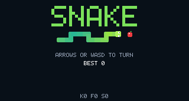
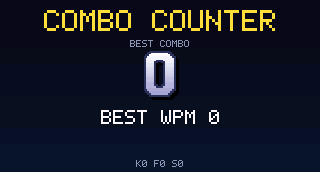
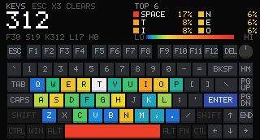

# Rainy75 V2 IPS 螢幕固件合集

Rainy75 V2 鍵盤 IPS 小螢幕（320×172）的非官方固件，以及在瀏覽器裡就能用的燒錄工具和素材安裝工具。
只改螢幕，不動鍵盤主控和接收器；隨時可以刷回原廠固件。所有畫面都在鍵盤裡運行，不需要在電腦上開任何程式。

## Game Hub：一個固件，10 個小遊戲

刷一次 [`game-hub-v5`](firmware/collection/game-hub-v5/)，螢幕開機就是遊戲選單：**↑ ↓ 選遊戲，Enter 開始；遊戲中 1.5 秒內連按 3 次 Esc 回選單**。
程式全部在螢幕晶片裡，比較大的圖片放在螢幕的外置 Flash，用網頁工具裝一次就好。

| # | 遊戲 | 一句話 | 圖片素材 |
|---|---|---|---|
| 1 | [SNAKE](#1-snake貪吃蛇) | 經典貪吃蛇 | — |
| 2 | [YUXI SNAKER](#2-yuxi-snaker) | 頭像版貪吃蛇，吃美食越吃越快 | `AVATAR.BIN` |
| 3 | [MUSCLE VS GOBLIN](#3-muscle-vs-goblin猛男-vs-哥布林) | 同一把鍵盤雙人格鬥 | `FIGHT.BIN` |
| 4 | [TYPING BOSS](#4-typing-boss打字打怪) | 打字攻擊 Boss，10 關 | `BOSS.BIN` |
| 5 | [TYPING PET](#5-typing-pet打字電子雞) | 打字餵電子雞，從蛋養到國王 | `PET.BIN` |
| 6 | [COMBO COUNTER](#6-combo-counter打字連擊) | 打字連擊數＋即時 WPM | — |
| 7 | [LETTER RAIN](#7-letter-rain字母雨) | 按的鍵變成鍵帽從天而降 | — |
| 8 | [KEY HEATMAP](#8-key-heatmap按鍵熱圖) | 75% 配列按鍵熱圖 | — |
| 9 | [MAID YUXI](#9-maid-yuxi粉色女僕) | 粉色女僕，打字就飛、冒愛心 | — |
| 10 | [BIGHEAD MAID YUXI](#10-bighead-maid-yuxi粉色女僕大頭版) | 同上，大頭版 | — |

### 安裝 Game Hub

需要：Chrome 或 Edge（支援 WebHID）、**USB 數據線**（接收器、藍牙都不行）。先關掉官方網頁驅動等其他會連鍵盤的頁面或程式。

1. **刷固件**：用瀏覽器打開 [`flasher/IPS固件燒錄工具.html`](flasher/IPS固件燒錄工具.html)，選 [`firmware/collection/game-hub-v5/ips-game-hub-v5.bin`](firmware/collection/game-hub-v5/)，工具會顯示「Game Hub v5 遊戲合集（10 個遊戲）」，勾選確認後燒錄，**寫入期間不要拔線**。
2. **底圖**：螢幕必須正在播放一張 320×172 滿屏 GIF，選單和遊戲是蓋在 GIF 播放畫面上的。用官方 Web 驅動上傳資料夾裡的 `底圖-320x172.gif` 並切到它即可（只需做一次，四個自訂位置放哪一個都可以；之前做過就不用再做）。
3. **裝圖片素材**：用瀏覽器打開 [`flasher/GameHub素材安裝工具.html`](flasher/GameHub素材安裝工具.html)，把 [`game-hub-v5/素材/`](firmware/collection/game-hub-v5/素材/) 裡的 4 個 `.BIN` 拖進去，按「連接鍵盤並安裝」。檔案一個一個傳，卡住會自動重傳；中斷不會弄壞螢幕上原有的檔案。
4. 回到選單按一下 ↑ 或 ↓：遊戲旁邊的 `NO FILE` 消失就完成了。沒裝素材的遊戲仍可選，會顯示缺哪個檔。

- 按鍵照樣會傳到電腦（螢幕只是「聽到」按鍵），在選單按 Enter 也會在電腦上按 Enter，玩之前先切到空白視窗。
- 螢幕只收得到「按下」：所有操作都是點按。Ctrl / Shift / Alt / Win / Fn 螢幕收不到。
- 每個遊戲的分數、統計只存在記憶體，換遊戲或斷電就清空。
- 選單最下面一行、遊戲角落的小字（K / F / S 等）是診斷讀數，可以忽略。
- 刷固件不會清掉已上傳的 GIF 和素材。

---

### 1. SNAKE：貪吃蛇

方向鍵或 W A S D 轉向（點一下轉一次，不能直接掉頭；一格內連按兩次會排隊，可以急轉 U 字）。吃蘋果變長、加分，越吃越快；撞牆或撞到自己就 GAME OVER，0.5 秒後按任意鍵重來。

### 2. YUXI SNAKER

頭像版貪吃蛇：方向鍵或 W A S D 轉向，吃漢堡、雞腿、甜甜圈、披薩加分、變長、變快。結束畫面是會抽泣、掉眼淚的哭臉。需要 `AVATAR.BIN`。

### 3. MUSCLE VS GOBLIN：猛男 vs 哥布林

同一把鍵盤兩個人對打，各 100 血，打到 0 就 KO，接著播勝方的結局動畫。需要 `FIGHT.BIN`。

| | 移動（點一下滑一步） | 招式 1 / 2 / 3 |
|---|---|---|
| 左：猛男 | `A` / `D` | `Q` / `W` / `E`（直拳 / 膝撞 / 震地） |
| 右：哥布林 | `J` / `L` 或 `←` / `→` | `U` / `I` / `O`（橫掃 / 頭槌 / 砸地） |

招式 1 快、招式 2 帶衝刺、招式 3 蓄力最久但最痛；蓄力中被打到會被打斷。

### 4. TYPING BOSS：打字打怪

平常打字就好，每個鍵就是一次攻擊。兩鍵間隔不到 1 秒算連擊，連擊越高傷害越高、越容易暴擊，每第 25 下是超必殺。10 關哥布林與猛男交替，顏色從原色、黃、藍、紅到煥彩，全破有獎勵動畫；停手太久 Boss 會嘲諷、回血。需要 `BOSS.BIN`。

### 5. TYPING PET：打字電子雞

每按一個鍵就是一顆食物，從畫面下方飛進牠嘴裡。300 鍵孵化，之後依累計按鍵數長成成年、騎士、國王，每次進化都有動畫。不打字會餓、心情會變差。需要 `PET.BIN`。

### 6. COMBO COUNTER：打字連擊

每按一個鍵連擊加 1，停手約 1.3 秒就結算（連擊數、最高 WPM、評語）。左上角是即時 WPM；速度越快特效越誇張：GOOD 邊框發光、GREAT 火焰、INSANE 彩虹數字加雷電。

### 7. LETTER RAIN：字母雨

按的字元變成一顆鍵帽，從它在鍵盤上的位置正上方掉下來堆起來；F 鍵類是金色星星、方向鍵是銀色箭頭、Tab 是愛心。空白鍵讓整排鍵帽跳起一道漣漪（空的地方冒出水波），並在右上能量條亮一格；第 10 下觸發地震讓整堆下沉。堆到幾乎滿版會爆炸。

### 8. KEY HEATMAP：按鍵熱圖

Rainy75 的 75% 配列縮圖：按下的鍵會亮一下，鍵帽底色代表按過幾次（灰→藍→綠→黃→橘→紅）。左上是總按鍵數，右上是最常按的前 6 名。想重新統計：回選單再進來即可（在 Game Hub 裡連按 3 次 Esc 是回選單）。

### 9. MAID YUXI：粉色女僕

粉色女僕 Q 版小人：打字就在整個螢幕裡飛，身後一串粉色小愛心，每按一鍵頭頂冒出一顆愛心；停手被重力拉回地面、彈一兩下再停下。

### 10. BIGHEAD MAID YUXI：粉色女僕大頭版

同樣的飛行和愛心特效，人物換成大頭小身體，臉更清楚。

---

## 單獨固件

只想要其中一個畫面、不要選單的話，也可以刷單獨的固件（同一個燒錄工具，同樣需要播放 320×172 的 GIF）。

| 固件 | 內容 | SHA-256 開頭 |
|---|---|---|
| [`fight-v2`](firmware/collection/fight-v2/) | 猛男 vs 哥布林（開機直接進遊戲） | `ce8e50e4` |
| [`maid-hop-v1`](firmware/collection/maid-hop-v1/) | 粉色女僕 按鍵飛行，60fps | `24d91708` |
| [`maid-bighead-v1`](firmware/collection/maid-bighead-v1/) | 粉色女僕 大頭版，60fps | `55aa472e` |
| [`stock`](firmware/stock/) | 原廠 IPS v2，恢復用 | `32defab7` |

完整雜湊見 [`firmware/SHA256SUMS.txt`](firmware/SHA256SUMS.txt)。燒錄工具選檔後會顯示固件名稱和 SHA-256，請核對一致再燒。

## 恢復原廠

同一個燒錄工具選 `firmware/stock/ips-original-v2.bin` 刷回即可。外置 Flash 裡的素材檔不影響原廠固件。

## 免責聲明

非官方固件，與鍵盤廠商無關。刷寫有使螢幕暫時無法使用的風險；燒錄工具只處理 IPS 螢幕，失敗時通常可以重新刷原廠固件恢復。使用風險自負。
