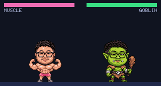
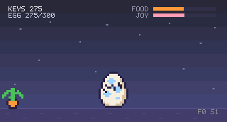
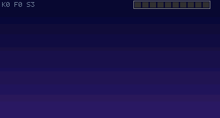
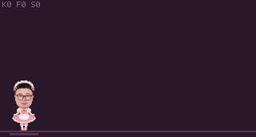
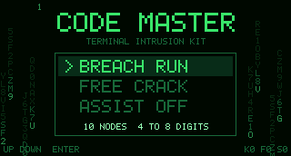
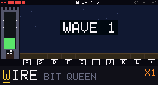
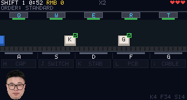
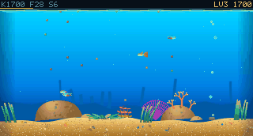

# Rainy75 V2 IPS GameHub

把 Rainy75 V2 鍵盤的 IPS 小螢幕（320×172）變成一台「小霸王遊戲機」：**一個固件裡裝很多小遊戲，開機就是遊戲選單**，之後會持續加入新遊戲。
只改螢幕，不動鍵盤主控和接收器；所有遊戲都在鍵盤裡運行，不需要在電腦上開任何程式；隨時可以刷回原廠固件。

## Game Hub：一個固件，17 個小遊戲

刷一次 [`game-hub-v9`](firmware/collection/game-hub-v9/)，螢幕開機就是遊戲選單：**↑ ↓ 選遊戲，Enter 開始；遊戲中 2 秒內連按 5 次 Esc 回選單**（中間按了別的鍵就重新計算，平常打字不會誤觸）。
鍵盤休眠或關機再開，會**直接回到上次在玩的遊戲**；上次停在選單，就停在選單、游標在上次玩的遊戲上。
程式全部在螢幕晶片裡，比較大的圖片放在螢幕的外置 Flash，用網頁工具裝一次就好。

| # | 遊戲 | 一句話 | 圖片素材 |
|---|---|---|---|
| 1 | [SNAKE](#1-snake貪吃蛇) | 經典貪吃蛇 | — |
| 2 | [YUXI SNAKER](#2-yuxi-snaker) | 頭像版貪吃蛇，吃美食越吃越快 | `AVATAR.BIN` |
| 3 | [MUSCLE VS GOBLIN](#3-muscle-vs-goblin猛男-vs-哥布林) | 同一把鍵盤雙人格鬥 | `FIGHT.BIN` |
| 4 | [TYPING BOSS](#4-typing-boss打字打怪) | 打字攻擊 Boss，10 關 | `BOSS.BIN` |
| 5 | [TYPING PET](#5-typing-pet打字電子雞) | 打字餵電子雞，從蛋養到國王 | `PET.BIN` |
| 6 | [COMBO COUNTER](#6-combo-counter打字連擊) | 打字連擊數＋即時 WPM | — |
| 7 | [LETTER RAIN](#7-letter-rain字母雨) | 按的鍵變成鍵帽從天而降 | — |
| 8 | [KEY HEATMAP](#8-key-heatmap按鍵熱圖) | 75% 配列按鍵熱圖 | — |
| 9 | [MAID YUXI](#9-maid-yuxi粉色女僕) | 粉色女僕，打字就飛、冒愛心 | — |
| 10 | [BIGHEAD MAID YUXI](#10-bighead-maid-yuxi粉色女僕大頭版) | 同上，大頭版 | — |
| 11 | [CODE MASTER](#11-code-master數字密碼破解) | 駭客終端風格的數字密碼破解，10 個節點闖關 | — |
| 12 | [KEY GUARD](#12-key-guard鍵盤塔防) | 打字賺能量、主行鍵蓋炮塔，守住 20 波 Bug | `GUARD.BIN` |
| 13 | [TUG OF WAR](#13-tug-of-war拔河對決) | 猛男 vs 哥布林拔河，1P 三關或雙人 | `TUG.BIN` |
| 14 | [WOB QC](#14-wob-qc鍵盤工廠質檢) | 鍵盤工廠傳送帶質檢：蓋章、彈飛、分箱 | `WOBQC.BIN` |
| 15 | [KEYQUARIUM](#15-keyquarium鍵盤水族館) | 打字餵魚的水族箱，越打越熱鬧 | `AQUA.BIN` |
| 16 | [OFFICE CAT](#16-office-cat辦公室貓咪) | 小貓陪你打字，看速度和退格判斷工作狀態 | `OFFCAT.BIN` |
| 17 | [SHARINGAN](#17-sharingan寫輪眼桌布) | 寫輪眼互動桌布：越打越進化，打得越快轉得越快 | `SHARINGN.BIN` |

### 安裝 Game Hub

需要：Chrome 或 Edge（支援 WebHID）、**USB 數據線**（接收器、藍牙都不行）。先關掉官方網頁驅動等其他會連鍵盤的頁面或程式。

1. **刷固件**：用瀏覽器打開 [`flasher/IPS固件燒錄工具.html`](flasher/IPS固件燒錄工具.html)，選 [`firmware/collection/game-hub-v9/ips-game-hub-v9.bin`](firmware/collection/game-hub-v9/)，工具會顯示「Game Hub v9 遊戲合集（17 個遊戲，開機回到上次的遊戲）」，勾選確認後燒錄，**寫入期間不要拔線**。
2. **底圖**：螢幕必須正在播放一張 320×172 滿屏 GIF，選單和遊戲是蓋在 GIF 播放畫面上的。用官方 Web 驅動上傳資料夾裡的 `底圖-320x172.gif` 並切到它即可（只需做一次，四個自訂位置放哪一個都可以；之前做過就不用再做）。
3. **裝圖片素材**：用瀏覽器打開 [`flasher/GameHub素材安裝工具.html`](flasher/GameHub素材安裝工具.html)，把 [`game-hub-v9/素材/`](firmware/collection/game-hub-v9/素材/) 裡的 10 個 `.BIN`（共約 1.7 MB）拖進去，按「連接鍵盤並安裝」。檔案一個一個傳，卡住會自動重傳；中斷不會弄壞螢幕上原有的檔案。
4. 回到選單按一下 ↑ 或 ↓：遊戲旁邊的 `NO FILE` 消失就完成了。沒裝素材的遊戲仍可選，會顯示缺哪個檔。

- 按鍵照樣會傳到電腦（螢幕只是「聽到」按鍵），在選單按 Enter 也會在電腦上按 Enter，玩之前先切到空白視窗。
- 螢幕只收得到「按下」：所有操作都是點按。Ctrl / Shift / Alt / Win / Fn 螢幕收不到。
- 每個遊戲的分數、統計只存在記憶體，換遊戲或斷電就清空；開機回到上次的遊戲時，是從該遊戲的開頭重新開始。
- 選單最下面一行、遊戲角落的小字（K / F / S 等）是診斷讀數，可以忽略。
- 刷固件不會清掉已上傳的 GIF 和素材；從 v6 升級只要再裝 `SHARINGN.BIN`，從 v5 升級再加 GUARD、TUG、WOBQC、AQUA、OFFCAT。

---

### 1. SNAKE：貪吃蛇

方向鍵或 W A S D 轉向（點一下轉一次，不能直接掉頭；一格內連按兩次會排隊，可以急轉 U 字）。吃蘋果變長、加分，越吃越快；撞牆或撞到自己就 GAME OVER，0.5 秒後按任意鍵重來。

### 2. YUXI SNAKER

頭像版貪吃蛇：方向鍵或 W A S D 轉向，吃漢堡、雞腿、甜甜圈、披薩加分、變長、變快。結束畫面是會抽泣、掉眼淚的哭臉。需要 `AVATAR.BIN`。

### 3. MUSCLE VS GOBLIN：猛男 vs 哥布林

同一把鍵盤兩個人對打，各 100 血，打到 0 就 KO，接著播勝方的結局動畫。需要 `FIGHT.BIN`。

| | 移動（點一下滑一步） | 招式 1 / 2 / 3 |
|---|---|---|
| 左：猛男 | `A` / `D` | `Q` / `W` / `E`（直拳 / 膝撞 / 震地） |
| 右：哥布林 | `J` / `L` 或 `←` / `→` | `U` / `I` / `O`（橫掃 / 頭槌 / 砸地） |

招式 1 快、招式 2 帶衝刺、招式 3 蓄力最久但最痛；蓄力中被打到會被打斷。

### 4. TYPING BOSS：打字打怪

平常打字就好，每個鍵就是一次攻擊。兩鍵間隔不到 1 秒算連擊，連擊越高傷害越高、越容易暴擊，每第 25 下是超必殺。10 關哥布林與猛男交替，顏色從原色、黃、藍、紅到煥彩，全破有獎勵動畫；停手太久 Boss 會嘲諷、回血。需要 `BOSS.BIN`。

### 5. TYPING PET：打字電子雞

每按一個鍵就是一顆食物，從畫面下方飛進牠嘴裡。300 鍵孵化，之後依累計按鍵數長成成年、騎士、國王，每次進化都有動畫。不打字會餓、心情會變差。需要 `PET.BIN`。

### 6. COMBO COUNTER：打字連擊

每按一個鍵連擊加 1，停手約 1.3 秒就結算（連擊數、最高 WPM、評語）。左上角是即時 WPM；速度越快特效越誇張：GOOD 邊框發光、GREAT 火焰、INSANE 彩虹數字加雷電。

### 7. LETTER RAIN：字母雨

按的字元變成一顆鍵帽，從它在鍵盤上的位置正上方掉下來堆起來；F 鍵類是金色星星、方向鍵是銀色箭頭、Tab 是愛心。空白鍵讓整排鍵帽跳起一道漣漪（空的地方冒出水波），並在右上能量條亮一格；第 10 下觸發地震讓整堆下沉。堆到幾乎滿版會爆炸。

### 8. KEY HEATMAP：按鍵熱圖

Rainy75 的 75% 配列縮圖：按下的鍵會亮一下，鍵帽底色代表按過幾次（灰→藍→綠→黃→橘→紅）。左上是總按鍵數，右上是最常按的前 6 名。想重新統計：1 秒內連按 3 次 Esc，熱度清零並有一道白光掃過（連按 5 次則是回選單）。

### 9. MAID YUXI：粉色女僕

粉色女僕 Q 版小人：打字就在整個螢幕裡飛，身後一串粉色小愛心，每按一鍵頭頂冒出一顆愛心；停手被重力拉回地面、彈一兩下再停下。

### 10. BIGHEAD MAID YUXI：粉色女僕大頭版

同樣的飛行和愛心特效，人物換成大頭小身體，臉更清楚。

### 11. CODE MASTER：數字密碼破解

駭客終端風格的猜密碼（Mastermind）。用數字列輸入，Enter 送出、Backspace 刪除。每格會逐一「解密」：實心綠 = 數字和位置都對（LOCK），琥珀空框 = 有這個數字但不在這位（ECHO），灰 = 沒有。數字可以重複，右邊 0–9 狀態鍵幫你記住每個數字的狀態。

- **BREACH RUN**：10 個節點闖關，密碼從 4 位一路加到 8 位，TRACE 追蹤條一直上漲，滿了就被抓到。破解節點會降低 TRACE。
- **FREE CRACK**：單局，自選位數。
- **ASSIST**：主選單第三項，打開後右側顯示可能性矩陣，自動劃掉不可能的數字。
- 空白鍵 SCAN：直接揭示一個還沒確定的位置（次數有限）。

### 12. KEY GUARD：鍵盤塔防

Bug 從右邊爬向左邊的基地塔。主行 `A S D F G H J K L ;` 就是戰場上由左到右的 10 格：按一格，沒有塔就蓋炮塔、已經有塔就升級（米白單管 → 藍色雙管 → 金色雷射）。

- 能量來自打字：照底部的單詞打（只用上排和下排字母，不會按到防線鍵），連擊越高能量越多；金色詞雙倍、青色詞免費劈雷、粉色詞回血。
- 炮塔會耗電，不打字就斷電停火。
- `Space` 準備落雷，再按一格劈下去。
- 甲蟲、紅螞蟻、犀牛甲蟲、蒼蠅、會鑽地的蟲、鏽蟲、炸彈蟲，每 5 波一隻蜘蛛王（會吐網封塔，連按該格撕網）；撐過 20 波就勝利。

### 13. TUG OF WAR：拔河對決

肌肉猛男（左）對哥布林（右），兩邊的女僕在身後喊加油。左邊 `A` `S` 交替狂按，右邊 `←` `→` 交替狂按（同一個鍵連按不算）。

- 選單 ↑ ↓ 選 LV1 EASY / LV2 NORMAL / LV3 HARD（對電腦）或 2P VS（雙人），Enter 開始。
- 中間會閃出一對鍵（例如 `D | K`），先按到自己那個的一方暴擊；按錯會暈一下。倒數時搶跑會被往對面拉。
- 每局 30 秒，把繩結拉過去或時間到領先就贏，三局兩勝；輸的人被拖進泥坑。贏了按 Enter 挑戰下一關。

### 14. WOB QC：鍵盤工廠質檢

鍵盤零件（鍵帽、軸體、衛星軸、PCB、線材）在 5 列的傳送帶上從左往右走，按零件「目前所在那一列」的鍵：

- 上排 `Q W E R T`：蓋 QC 章（良品）。
- 中排 `A S D F G`：把次品彈飛（長條空白鍵要同時按它壓著的兩個鍵）。
- `H J K L ;`：第 3 班起，把蓋好章的零件丟進那一列底下的零件箱，要分對箱。

每出貨一個良品營收 +559 元；次品流出去或丟進箱子會扣心，三顆心扣完工廠倒閉。每一班有訂單卡（例如只要紅軸、召回藍色鍵帽），後面還會出現蟲子和金軸。標題選班次模式（8 班＋總評級）或無盡模式；`Space` 暫停。左下角的老闆會看你的表現喊話。

### 15. KEYQUARIUM：鍵盤水族館

開著放旁邊就好：平常打字就是在餵魚。

- 每個鍵的飼料掉在它在鍵盤上的位置正上方（按 `Q` 掉在左邊、按 `P` 掉在右邊），魚會游過去搶，吃飽會長大。
- 同一排鍵快速從左往右（或從右往左）劃過 5 個以上，掀起一道水流：水草彎、魚被推走。
- 空白鍵讓打氣石冒一串氣泡。
- 累計按鍵越多，水族箱越熱鬧：水草、霓虹燈魚、小丑魚與海葵、神仙魚、蝸牛和小蝦、河豚、小海龜，2 萬鍵時變成夢幻水族箱。
- 3 分鐘沒打字燈會變暗、魚去睡覺；魚不會死。

### 16. OFFICE CAT：辦公室貓咪

一隻 Q 版小貓坐在桌前陪你打字：你按一下，牠就敲一下鍵盤。牠看你的打字速度和退格次數判斷工作狀態：

- 打得又快又少退格，持續一陣子就進入「心流」：戴上墨鏡、爪子打出殘影。
- 一直按退格壓力會上升：冒汗 → 毛炸開 → 筆電旁邊起火；繼續好好打字，壓力降下來就會被滅火器噴熄。永遠不會 game over。
- 停下來小貓會喝茶、想事情，太久沒打字就趴著睡覺。
- 打得越多，桌面越豐富（茶杯、盆栽、檯燈、新筆電……）。連按 3 次 Enter 看今天的報告。

### 17. SHARINGAN：寫輪眼桌布

開著當桌布，平常打字就好：寫輪眼在畫面中央慢慢轉動。

- 每打 50 個鍵進化一次，23 個形態依序出現，換形時會猛轉一圈再淡入下一個形態；第 23 個之後回到第一個。
- 打得越快轉得越快；停手就停在目前的形態，不會退回去，只是轉速慢下來。
- 畫面上沒有任何數字，只有眼睛。

---

## 恢復原廠

同一個燒錄工具選 [`firmware/stock/ips-original-v2.bin`](firmware/stock/) 刷回即可（SHA-256 開頭 `32defab7`，完整雜湊見 [`firmware/SHA256SUMS.txt`](firmware/SHA256SUMS.txt)）。外置 Flash 裡的素材檔不影響原廠固件。

## 免責聲明

非官方固件，與鍵盤廠商無關。刷寫有使螢幕暫時無法使用的風險；燒錄工具只處理 IPS 螢幕，失敗時通常可以重新刷原廠固件恢復。使用風險自負。
